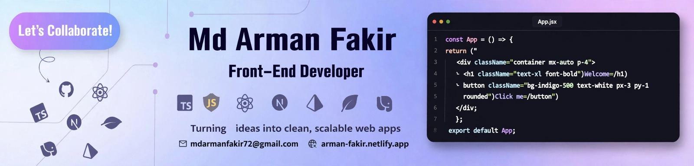

<h1 align="center">Hi 👋, I'm Md Arman Fakir</h1>

  

- 👋 Hi, I’m **[@mdarmanfakir](https://github.com/mdarmanfakir)**
- 💻 I’m currently working on **React.js, Next.js, TypeScript and Tailwind** for frontend development.
- 🌱 I’m currently learning **Next.js, TypeScript and Framer Motion.**
- 💬 Ask me about **Front-End (React, Next, JavaScript, Tailwind).**
- 🌐 Explore My Portfolio **[Arman Fakir](https://arman-fakir.netlify.app)** and My **Resume**
- 📝 I regularly write articles on **[LinkedIn](https://www.linkedin.com/in/arman-fakir/)**
- 📫 Feel free to reach me out **[Email](mailto:mdarmanfakir72@gmail.com)**

<h3 align="left">FOLLOW ME ON SOCIALS:</h3>

---

   

<h3 align="left">🛠️ TECHNOLOGY STACK:</h3>

---

<b>Languages:</b>

   

<b>CSS Frameworks:</b>

 

<b>JavaScript Frameworks & Libraries:</b>

 

<b>Deployment Platform:</b>

  

<h3 align="left">🎨 Design:</h3>

<h3 align="left">🧰 Tools:</h3>

   

<h3 align="left">📊 GITHUB STATISTICS & ANALYSIS:</h3>

---

<b>GitHub Contributions:</b>

  

<h3 align="left">💬 RANDOM DEV QUOTE:</h3>

---

  

---

  

